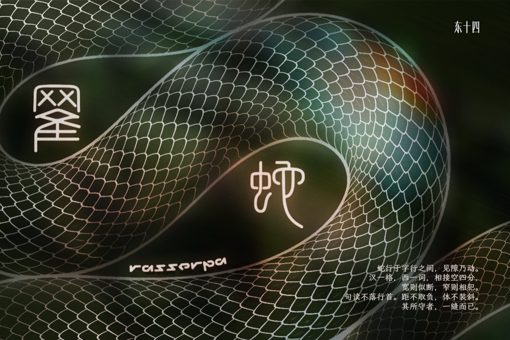

# Rassarpa · CJK–Latin mixed typesetting

[](https://github.com/L4ST-afk/rassarpa/actions/workflows/selfcheck.yml)
[](https://github.com/L4ST-afk/rassarpa/releases/latest)

[中文](README.md) · English



Rassarpa is a rule set — plus two small scripts and one stylesheet — for Chinese text that carries English words and Arabic digits. It handles one seam: the gap between an ideograph and a Latin run, and everything that decision touches.

**This seam is unoccupied ground.** Chrome's Modern Web Guidance ships 209 guides; `autospace` and `CJK` each appear **zero** times in them (offline package 1.0.0 + `5e5cd33`, checked 2026-11-20). The nearest guide, `visual-design/typography.md`, is Latin-only: `line-height: 1.5`, `max-width: 60ch` — a floor and a width that is too generous for Chinese.

**Measured, not quoted** (HeadlessChrome 158, macOS, PingFang SC):

| What | Value |
|---|---|
| `text-autospace: normal`, one boundary | 0.125 em (4px at 32px), ratio constant |
| Declared nothing vs `no-autospace` | identical — **undeclared means off** |
| A string that already holds an ASCII space | 0 difference — **the usual test deceives itself** |
| `.mx` empty inline box | 0.25 em (4px × 2) |
| `text-spacing-trim: normal`, PingFang SC | −16px |
| `text-spacing-trim: normal`, Songti SC / Heiti SC | 0, while `CSS.supports()` returns true |

So the default here is the sized box, not the CSS property: **quarter-em is the target, 1/8 em is what engines give.**

## Use it

```html
<html lang="zh-CN">
<link rel="stylesheet" href="tools/cjk-typo.css">
<article class="cjk">…</article>
<script src="tools/cjk_spacing.js"></script>
<script>new CJKSpacing('.cjk').run()</script>
```

- `lang` on the root element is mandatory; no stylesheet replaces it.
- The gap comes from `.mx` boxes at 1/4 em, symmetric, and no characters are copied out with the text.
- `class="cjk--autospace"` hands the gap to the engine instead: 1/8 em, one-sided in Safari, no punctuation squeezing.

## Install and self-check

Two ways in, pick one:

- **As an agent skill**: grab `rassarpa-0.1.1-skill.zip` from [Releases](https://github.com/L4ST-afk/rassarpa/releases/latest), unzip, then move the whole folder into your agent's `skills directory` (the folder name stays `rassarpa`). `SKILL.md` is the rule book; scripts and `references/` are read on demand.
- **As plain web code**: copy `tools/cjk-typo.css` and `tools/cjk_spacing.js` into your page and follow the snippet above. Nothing else is required.

Then verify — this script is the repository's selftest:

```bash
python3 tools/selfcheck.py     # exit code 0 = all five checks pass (API names, refs on disk, §9 anchors, stylesheet red lines, checker has teeth)
```

## Scope

Rules for: the gap, punctuation squeezing, quote style, line breaking and alignment, vertical / multi-column / annotation variants, and five web-side hard rules (`lang`, no negative letter-spacing, no faux italic, minimum size, explicit CJK font stack).

Not for: Latin-only typesetting, Chinese without a language boundary, poster-level display type (except the three character-level hard rules above).

## Upstream

heti (MIT) and pangu.js (MIT) are internalized in `tools/cjk_spacing.js`. Measure (`dososo/blcaptain-measure-cjk`, code Apache-2.0, font data CC BY 4.0) supplies the rule numbering and the checking discipline; its `measure.css` and `data/licenses.json` are **not vendored** — font licensing is live data and a snapshot would harden into a wrong answer.

MIT, see [LICENSE](LICENSE).
