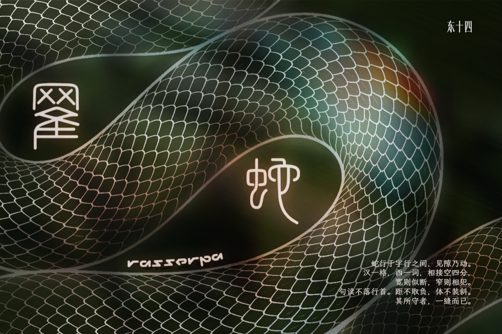

# 罗蛇 · Rassarpa

[](https://github.com/L4ST-afk/rassarpa/actions/workflows/selfcheck.yml)
[](https://github.com/L4ST-afk/rassarpa/releases/latest)
[](LICENSE)

`Rassarpa` · [English](README.en.md)



中文一格，西文一词，这里只理中间那道缝。

Rassarpa 是拉丁名，罗蛇是中文名。目录、包名、分支一律用 `rassarpa`。

一句话说清它管什么：汉字与英文单词、阿拉伯数字碰在一处时，那道间隙该不该有、有多宽、什么时候必须没有——以及围着这道缝的一整套判断。

写给两种人：排中英混排网页的，看下面四个读数和那行 CSS；把规则装进 agent 技能目录的，直接读 `SKILL.md`。

## 先说这块是空的

Chrome 团队那套《Modern Web Guidance》一共 209 篇指南，逐篇搜下来，`autospace` 和 `CJK` 一次都没出现。最接近的一篇 `visual-design/typography.md` 只讲西文：`line-height: 1.5`、`max-width: 60ch`——对中文，前者是下限，后者偏宽。查的是哪个版本、怎么搜的，记在 [docs/上游与许可.md](docs/上游与许可.md)。

W3C 那篇讲行内空白的文章至今写「目前没有浏览器会在不加样式时插入间隙」，三家引擎却都已支持 `text-autospace`，且**初始值都是关闭**。教程大多照前半句写，浏览器按后半句走，两个人量同一段文字会得出两个答案。

两处说法对不上，中间没有人量过。这个仓就做这一件事：给四个读数、两种错法、一条默认。

## 四个读数

实测，HeadlessChrome 158 · macOS · PingFang SC · 32px 与 64px 两档：

| 项 | 量到的值 |
|---|---|
| `text-autospace: normal`，单边界间隙 | +4px / +8px = **0.125 em**，比例恒定 |
| 不写声明 vs 显式 `no-autospace` | 差 0 —— **不声明等于关闭** |
| 串里已有 ASCII 空格时加 `normal` | 差 0 —— **测法本身会骗人** |
| `.mx` 空白盒 | +8px = **0.25 em**（四分空） |
| 挤压 · PingFang SC | −16px |
| 挤压 · Songti SC / Heiti SC | 0（`CSS.supports()` 却返回 true） |

要精确的四分空就加 `.mx` 空盒；省事交给 `text-autospace`，得接受它只给八分，正好一半。⛔ 别用普通空格凑。

量法与复跑见 [docs/测量方法.md](docs/测量方法.md)。

## 三步接上

```html
<html lang="zh-CN">
<link rel="stylesheet" href="tools/cjk-typo.css">
<article class="cjk">…</article>
<script src="tools/cjk_spacing.js"></script>
<script>new CJKSpacing('.cjk').run()</script>
```

1. `lang` 写在根元素上。CSS 替代不了——它是标点、字体回退、断行的前提。
2. 引样式，正文容器加 `class="cjk"`。间隙默认由 `.mx` 盒给足 1/4 em，两侧对称，复制不带走字符。
3. 要批量落间隙、把相邻标点挤半字，再引脚本跑一次。

想交给引擎（不插 DOM，约 1/8 em）：根容器加 `class="cjk--autospace"`。三条代价摆在这里：宽度只有一半、Safari 只在一侧加、不挤压标点。

## 当作 agent skill 用

整个目录放进你的 agent 的 skills 目录，`SKILL.md` 即判据正本（356 行，含反例、何时用／不用、体量预算、上游声明）。细则卷按问题取，⛔ 不通读七卷。

不想克隆：去 [Releases](https://github.com/L4ST-afk/rassarpa/releases/latest) 下 `rassarpa-0.1.1-skill.zip`，解压就是一个完整的技能目录，装好跑一遍上面的自检即算到位。

判据只有一份正本：`SKILL.md`。与细则卷冲突时，改细则卷。

## 跑自检

```bash
python3 tools/selfcheck.py
# 期望五项全 OK：API 名一致｜引用文件都在｜§九编号有落点｜开箱样式红线｜混用检查器有牙
python3 tests/test_spacing.py
# 期望末行 ALL OK：边界落间隙｜代码块不动｜标点挤压｜已有空格不被吃掉
```

单点检查器另有两个：

```bash
python3 tools/check_spacing_consistency.py <文件.md>       # 数字-量词混用（3 个 / 3个）
python3 tools/glyph_optical_correct.py --font <字体> --size 75 --mode fixed --json   # 逐字墨迹居中
```

## 已知限制

- **跨元素边界的缝，脚本补不上**：间隙按文本节点落，`<span>学习</span><span>CSS</span>` 这种把缝拆到两个元素上的写法拿不到盒子。WebKit 的原生 `text-autospace` 同样在元素边界不加。
- **Safari 与 Firefox 未实测**：单侧加间隙、元素边界丢缝这些说法来自 WebKit 记录，标「未复现」，引用时连这句一起引。
- **字体只覆盖三款测试字体**：挤压是否生效随字体而变，换字体要重量。

## 上游与许可

| 上游 | 许可 | 用了什么 |
|---|---|---|
| [赫蹏 heti](https://github.com/sivan/heti) | MIT | 挤压规则与正则思路，已并入 `tools/cjk_spacing.js` |
| [pangu.js](https://github.com/vinta/pangu.js) | MIT | 部分边界正则，文件头注明 |
| [分寸 · Measure](https://github.com/dososo/blcaptain-measure-cjk) | 代码 Apache-2.0；字体数据 CC BY 4.0 | 网页硬规则编号体系与校验纪律；`measure.css`、`data/licenses.json` **不内置，自取** |

不内置的理由一句话：字体授权是会变的数据，抄一份快照进仓库，等于把过期结论当正本。全文与本仓自己的许可见 [LICENSE](LICENSE)、[THIRD_PARTY_NOTICES.md](THIRD_PARTY_NOTICES.md)，取法与对拍见 [docs/上游与许可.md](docs/上游与许可.md)。

## 目录

```
SKILL.md                  判据正本：反例优先 → 规则 → 网页硬规则 → 体量预算 → 上游声明
references/               七卷细则（知识地图、排版通则、校验循环、字体授权、主题、光学修正、命名）
tools/
  cjk-typo.css            开箱样式（令牌 + .mx + 变体 + 暗色）
  cjk_spacing.js          浏览器端：逐文本节点包裹间隙与挤压盒
  cjk_spacing.py          服务端：同规则正则替换
  selfcheck.py            五项自检
  check_spacing_consistency.py   数字-量词混用
  glyph_optical_correct.py       逐字墨迹居中
  probe.html / measure.mjs       量具与跑法
tests/test_spacing.py     八条白盒回归
examples/demo.html        三种做法同屏，打开即见差别
docs/                     测量方法、上游与许可、判据表、封面文案
results/                  实测读数（JSON + Markdown）
```

## 不做什么

- 不做 CSS 框架、不发 npm 包。要现成排版样式，用赫蹏或汉字标准格式；本仓给判据与两个薄脚本。
- 不用字符凑间隙：不插普通空格，不插 `U+2009`。
- 不凭记忆引文献。抓不到原文就记「未获取」；字体授权结论回官方原文复核。

## 名字与题图

罗蛇／Rassarpa 取自谢灵运《罗浮山赋》的「罗，罗山也；浮，浮山也」——罗山与浮山相峙，一龟一蛇在图上对位，取名时把两边各取一字。来历见 [references/naming.md](references/naming.md)，只记录名字，不影响任何判据。

题图位图原件不进仓库；题诗、导出规则与两处待核见 [docs/封面.md](docs/封面.md)。

## 索引词

`CJK` · `typography` · `text-autospace` · `text-spacing-trim` · `mixed Chinese English spacing` · `四分空` · `中西文混排` · `punctuation squeezing` · `vertical writing` · `font stack`
